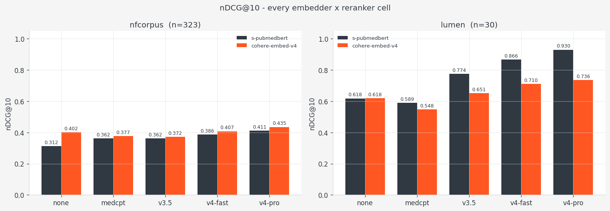
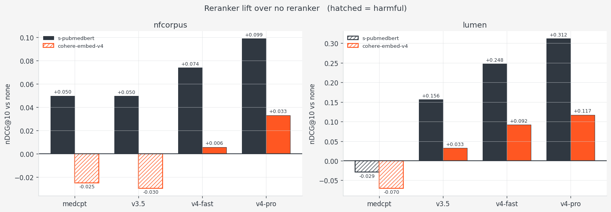
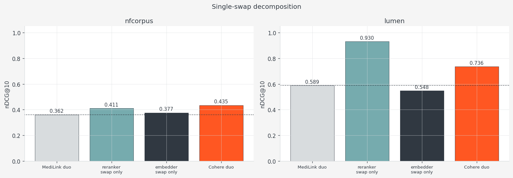
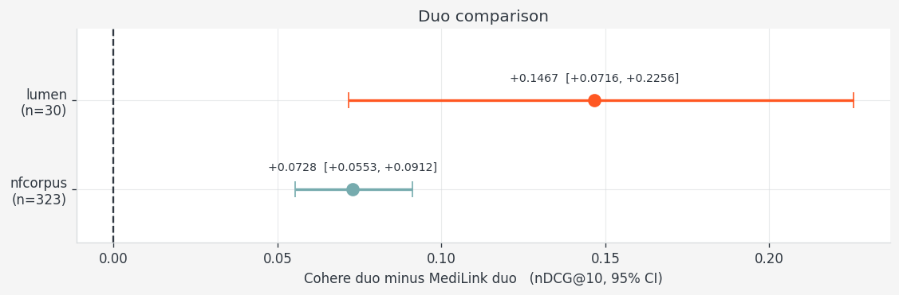
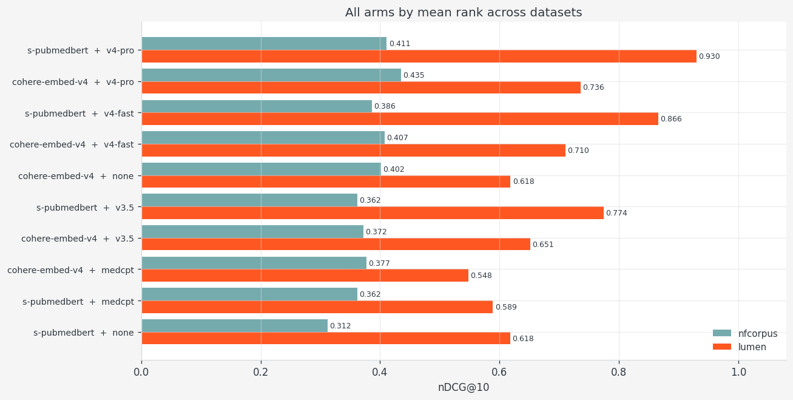

# Biomedical Reranker Benchmark

## Has the case for domain-specific retrieval models expired?

`S-PubMedBert` and `MedCPT` were trained on biomedical text and built for exactly this
task. `embed-v4` and `rerank-v4.0-pro` are general-purpose, trained on everything and
tuned for nothing in particular. The usual assumption is that the specialists win on
medical retrieval. This benchmark checks whether they still do.

| | Embedder | Reranker | What it is |
|---|---|---|---|
| **Domain stack** | `S-PubMedBert-MS-MARCO` | `MedCPT-Cross-Encoder` | Biomedical models, running in MediLink production today |
| **General stack** | `embed-v4.0` | `rerank-v4.0-pro` | Cohere, general-purpose, newer generation |

The domain stack knows the subject. The general stack has scale and newer models. Which
matters more is not obvious, and the answer may differ between a public benchmark and a
real production corpus, so both are tested.

## Design

The comparison is a **full grid**, not two stacks head to head. A single duo-vs-duo number
hides three separate questions:

```
                     none    medcpt   v3.5   v4-fast   v4-pro
s-pubmedbert          ·        ·       ·        ·        ·
cohere-embed-v4       ·        ·       ·        ·        ·
                      ↑        └──────────┬─────────────┘
              embedders only         rerankers, on identical candidates
```

Two embedders, five rerankers, ten arms. `none` does no reranking at all, so that column
compares the embedders directly. Every other cell reranks the *same* candidates its row's
embedder produced, so no arm can win by retrieving different documents.

| Read | Answers |
|---|---|
| The `none` column | Which **embedder** retrieves better on its own |
| Across one row | Which **reranker** does more with the same candidates |
| Across both rows | Whether the reranker's gain **depends on** the retriever |

All three Cohere tiers run, so the price/quality curve is measured rather than assumed.

## Evaluation

| Metric | What it measures |
|---|---|
| **nDCG@10** | Ranking quality. Rewards putting the most relevant passages highest |
| **Recall@{1,3,5,10}** | Coverage. How much relevant material reaches the top K |
| **MRR@10** | How high the first relevant passage lands |
| **Latency** | Median ms per query, rerank step only |

Scored with `pytrec_eval` through BEIR's `EvaluateRetrieval`, so the numbers are
comparable to published work.

Differences between stacks are tested with a **bootstrap confidence interval** over
per-query scores (10,000 resamples). nDCG is bounded and skewed, so a t-test does not
apply. If the interval crosses zero, the two stacks cannot be told apart on that sample,
and that is reported rather than hidden.

## Datasets

| | NFCorpus | LUMEN |
|---|---|---|
| Size | ~3.6K documents | 77,649 passages |
| Queries | 323 | 30 |
| Labels | **Human**, from BEIR | **LLM-judged**, TREC-style pooling |
| Role | Trusted public benchmark | The real production corpus |

NFCorpus is the trusted measurement. LUMEN is the corpus
[MediLink](https://github.com/MediLinkorg/Medilink_rag) actually serves, published at
[`mohamedkhaledmk7/LUMEN-rag-data`](https://huggingface.co/datasets/mohamedkhaledmk7/LUMEN-rag-data).
Its labels were built by pooling the top-10 from all five arms and grading them blind.

**LUMEN's labels come from a model, not people.** That is weaker evidence, so the two
datasets are always reported side by side and never averaged. If they agree, the result
is stronger. If they disagree, that is a finding in itself.

## Results



| | none | medcpt | v3.5 | v4-fast | v4-pro |
|---|---|---|---|---|---|
| **NFCorpus** · s-pubmedbert | 0.312 | 0.362 | 0.362 | 0.386 | **0.411** |
| **NFCorpus** · cohere-embed-v4 | 0.402 | 0.377 | 0.372 | 0.407 | **0.435** |
| **LUMEN** · s-pubmedbert | 0.618 | 0.589 | 0.774 | 0.866 | **0.930** |
| **LUMEN** · cohere-embed-v4 | 0.618 | 0.548 | 0.651 | 0.710 | **0.736** |

### Does each reranker actually help?



Every reranker measured against doing nothing. Hatched bars are the cases where reranking
made results **worse**. MedCPT is negative on Cohere candidates on NFCorpus and negative
on both embedders on LUMEN. v3.5 is negative on Cohere candidates too. The v4 tiers are
positive everywhere.

### Which swap did the work?



Start from the MediLink duo, change one component at a time. On both datasets the
**reranker swap carries more of the gain than the embedder swap**. On LUMEN, swapping only
the reranker (0.930) beats the full Cohere duo (0.736), because the domain embedder is
stronger on its own corpus.

### Duo comparison



The Cohere duo beats the MediLink duo on both datasets, and neither interval crosses zero:

| Dataset | Difference | 95% CI |
|---|---|---|
| NFCorpus (n=323) | +0.0728 | [+0.0553, +0.0912] |
| LUMEN (n=30) | +0.1467 | [+0.0716, +0.2256] |



## Findings

Ordered by how much weight each claim carries.

→ **MedCPT is the weakest reranker tested.** It often does worse than no reranking at all.
This shows up on both datasets and with both embedders. Looking query by query, it pushes
relevant passages down and irrelevant ones up, so it is a real ranking failure and not a
quirk of the metric. One caveat: pooling makes some of its LUMEN deficit look worse than
it is.

→ **The Cohere tiers rank in a clean order: v3.5 < v4.0-fast < v4.0-pro.** Same order on
both datasets and both embedders. v4.0-fast beats v3.5 on quality *and* runs faster, so
there is no reason to pick v3.5.

→ **The reranker mattered more than the embedder.** True on both datasets. The single-swap
chart shows it directly: changing the reranker moves the score more than changing the
embedder does.

→ **Which embedder wins depends on the dataset.** Cohere's embedder wins every comparison
on NFCorpus. S-PubMedBert wins on LUMEN, by bigger margins, against every reranker except
MedCPT. Domain overlap is the obvious explanation, but two datasets can show that the
effect is there without explaining why.

→ **Reranking helps most when retrieval is weak.** On NFCorpus, v4-pro adds 32% on top of
S-PubMedBert but only 8% on top of the stronger Cohere embedder. A better retriever leaves
less for the reranker to fix. The grid shows this; a duo comparison cannot.

## Limitations

Two datasets can show that an effect exists. They cannot explain why it happens.

**Two metrics are stuck at their ceiling on LUMEN.** Plain retrieval already puts a
relevant passage at rank 1 for 29 of 30 queries, so MRR@10 and Recall@1 have no room to
separate the arms. And the average query has about 23 relevant passages competing for 10
slots, so Recall@10 cannot go above roughly 0.43 no matter how good the ranking is.
nDCG@10 is the only metric with real range on LUMEN, and the conclusions rest on it.

**Latency is not a fair comparison.** MedCPT runs locally on a Colab T4. The Cohere
rerankers are API calls, so their times include a network round trip. MedCPT would be much
faster on better hardware. The three Cohere tiers are fair to compare against each other.
None of this affects the quality scores.

**Pooling is uneven between arms on LUMEN.** MedCPT has 11% of its top-10 results
unjudged, against 2% for v4-pro. Anything unjudged counts as irrelevant, so part of
MedCPT's deficit is a labelling gap rather than a real failure. Checking query by query
suggests most of it is real, but judging those passages is the proper fix.

**LUMEN has only 30 queries and model-generated labels.** Its confidence intervals are
about 4x wider than NFCorpus's. The two datasets are never averaged together.

**The judge may favour models like itself.** MedCPT helps on NFCorpus, where labels come
from people, and hurts on LUMEN, where labels come from Claude. Cohere's margin also
roughly doubles on LUMEN. Since the judge and the Cohere rerankers are both modern
general-purpose models, they may share a sense of what counts as relevant that a
biomedical specialist does not. The other explanation is simply that LUMEN is oncology and
NFCorpus is nutrition. Both fit the data. Re-judging with a different model would tell
them apart.

**Pooling misses what nobody found.** If no arm ranked a passage in its top 10, it never
got judged and counts as irrelevant. That is how TREC labels have always been built, but
it means LUMEN recall only measures what these five arms retrieved.

**Retrieval here is dense-only.** No BM25, no hybrid. MediLink production blends both, so
these numbers do not reproduce the live system. **LUMEN's queries were written against the
corpus**, so nearly all of them are answerable and the absolute scores run high.
Comparisons stay fair because every arm faces the same conditions.

## Recommendations

### For MediLink

→ **Reconsider MedCPT, but test first.** It is the weakest reranker here and by far the
slowest. Before replacing it, re-run the grid on hybrid retrieval with better labels,
since both caveats bear on this exact decision. If the result holds, v4.0-fast is the
obvious replacement: better quality at roughly a fifth of the time.

→ **Keep S-PubMedBert for now.** It wins on LUMEN against every reranker except MedCPT,
and LUMEN is the corpus the system actually serves. The embedder result is the uncertain
one, so do not act on it yet.

→ **Turn hybrid retrieval back on before deciding anything.** Everything here is
dense-only, and production is not.

### For the LUMEN labels

→ **Judge the unjudged passages first.** Closing the 11% vs 2% gap removes the biggest
caveat on the strongest finding, and it is the smallest job here.

→ **Re-judge a sample with a different model.** If MedCPT recovers under a non-Claude
judge, the problem was judge bias. If it does not, the result is real.

→ **Add queries and pool deeper.** Thirty queries make the intervals about 4x wider than
NFCorpus's. Pooling to depth 20 also makes the labels reusable by systems that were not
part of the pool.

→ **Use real user queries next time.** The current ones were written against the corpus,
so almost all are answerable. Real traffic includes questions the corpus cannot answer,
which is where retrieval actually fails.

### For general-purpose models in medical work

→ **Measure instead of assuming, in either direction.** The specialist lost here. That is
not a rule. Domain models still have strengths this benchmark never tested: rare terms,
abbreviations, drug names, text far from anything on the web.

→ **Test on the setup you actually run.** These results come from dense-only retrieval
over oncology papers. Hybrid retrieval over clinical notes could rank the same models
differently.

→ **Be careful with LLM-judged relevance.** If a model grades the results and a related
model is being graded, the two may agree with each other for reasons that have nothing to
do with being right. Use human labels where the budget allows.

→ **Ranking quality is not clinical safety.** nDCG says a relevant passage ranked highly.
It says nothing about whether that passage is current, matches guidelines, or is safe to
act on.

## Conclusion

The reranking result is consistent and points one way. MedCPT finishes last on both
corpora with both embedders, the newest general-purpose tier finishes first, and the
reranker moves the score more than the embedder does. The embedder result is mixed: the
domain model holds its own on the corpus it was built for, and two datasets are not enough
to say why.

**Current flagship general-purpose rerankers can beat domain-specific models on the domain
those models were built for.** Domain training was a reliable advantage when general
models were weaker. On this evidence it no longer is, at least for reranking. Picking a
specialist model is now a decision to justify with measurement, not a safe default.

## Repository

```
notebooks/
  01_medilink_rag_pipeline.ipynb      Reference. The production RAG pipeline this
                                       benchmark measures against. Adapted from team
                                       research at MediLinkorg. Not runnable standalone.

  02_Lumen_RAG_Qrels.ipynb            Builds relevance labels for LUMEN, which ships
                                       with none. TREC-style pooling, judged by Claude
                                       Haiku, blind and shuffled.

  03_Retrieval_Stack_Benchmark.ipynb  The comparison. 2 embedders x 5 rerankers on both
                                       datasets, scored with nDCG@10, Recall@K, MRR@10.

  04_Benchmark_Analysis.ipynb         All figures. Reads the tables from 03, makes no
                                       API calls, free to re-run.

results/
  qrels/                              LUMEN labels, query set, pool metadata
  Comparison_Visuals/                 Figures from notebook 04
```

## Reproducing

```bash
pip install -r requirements.txt
```

Run the notebooks in order: **02** (build the labels) → **03** (run the benchmark) → **04**
(draw the figures).

You need a Cohere API key (`COHERE_API_KEY`) and an Anthropic key (`ANTHROPIC_API_KEY`,
used only in notebook 02 for judging). Both prompt for input if not already set. The LUMEN
corpus and labels are public on HuggingFace and need no login; `HF_TOKEN` is optional and
only raises anonymous download limits. NFCorpus downloads itself.

**Cost at list prices**, on a Cohere production key: about $1 for judging in notebook 02,
and about $3.64 for notebook 03 across the full 323-query NFCorpus split, two candidate
sets and three rerank tiers. Notebook 04 is free.

A free Cohere trial key works with `N_QUERIES = 100` in notebook 03's config, to stay
inside the trial's 1,000 calls per month.

## Method notes

**Score normalization.** MedCPT returns raw logits, Cohere returns 0-1 relevance scores.
MedCPT's are sigmoid-mapped to the same range. This does not change the ranking, since
sigmoid is monotonic, but it matters if a score cutoff is ever applied.

**Rank-based scoring.** Rerankers produce scores on scales that are not comparable, so
results are converted to rank position before evaluation. Only the ordering is compared,
which is what nDCG, Recall and MRR measure anyway.

## Attribution

`notebooks/01_medilink_rag_pipeline.ipynb` is adapted from team research at
[`MediLinkorg/Medilink_rag`](https://github.com/MediLinkorg/Medilink_rag), part of the
MediLink healthcare platform. It is here as reference for what this benchmark measures
against, and needs a Weaviate instance, the PubMed corpus, and API keys to run.

## License

Code in this repo: MIT. The LUMEN corpus and its labels carry separate terms, see the
[dataset card](https://huggingface.co/datasets/mohamedkhaledmk7/LUMEN-rag-data).